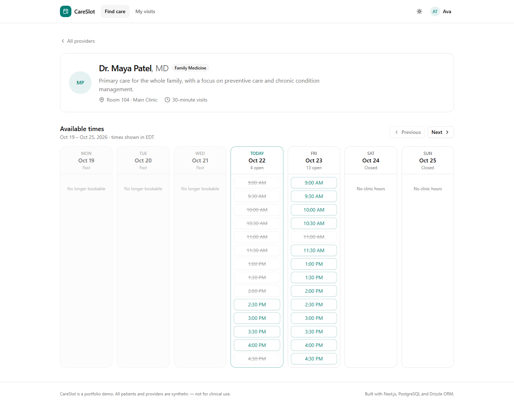
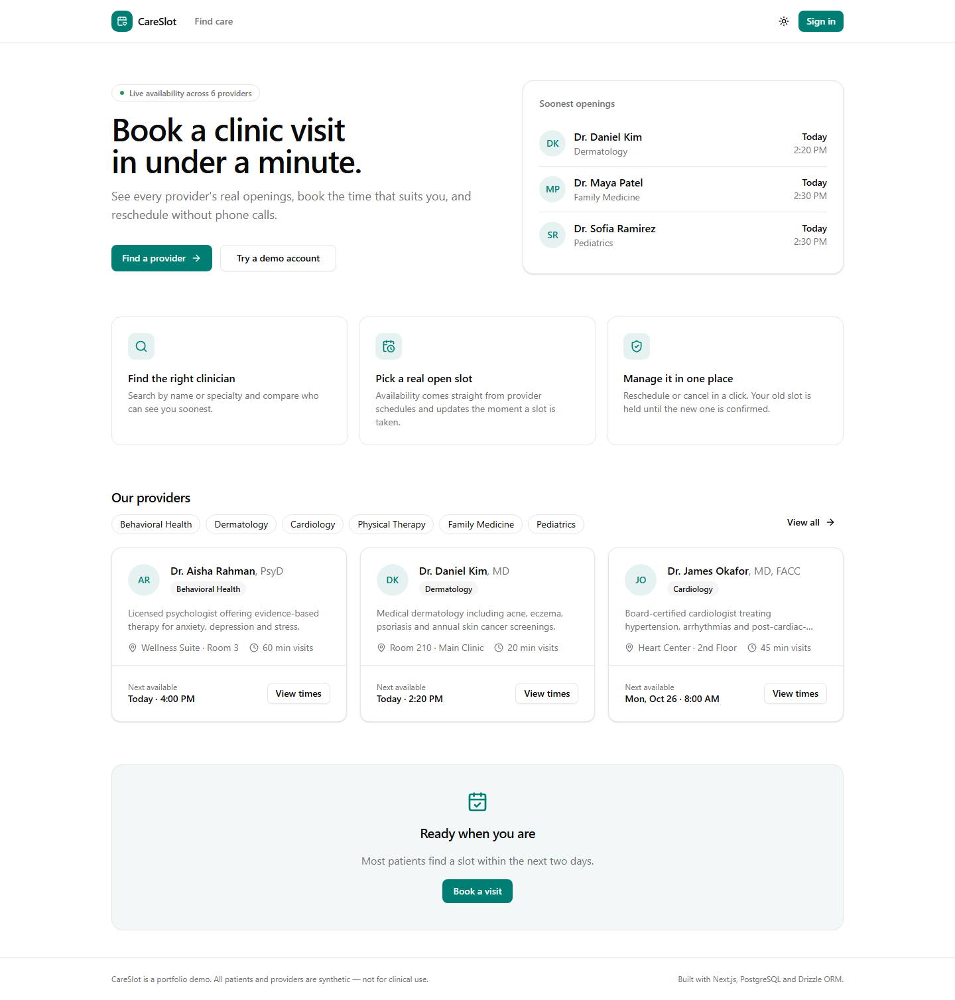
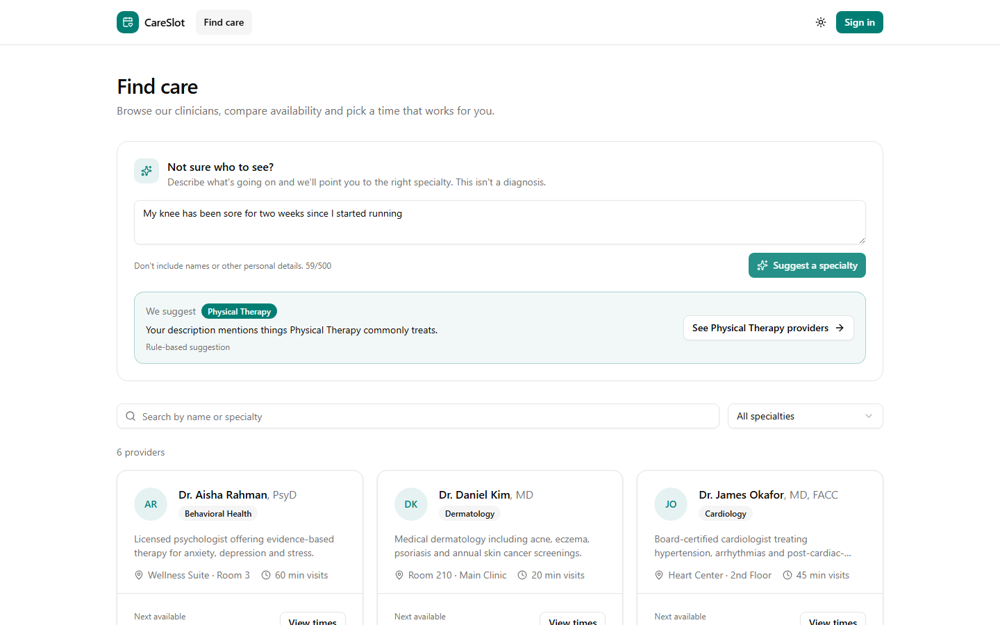
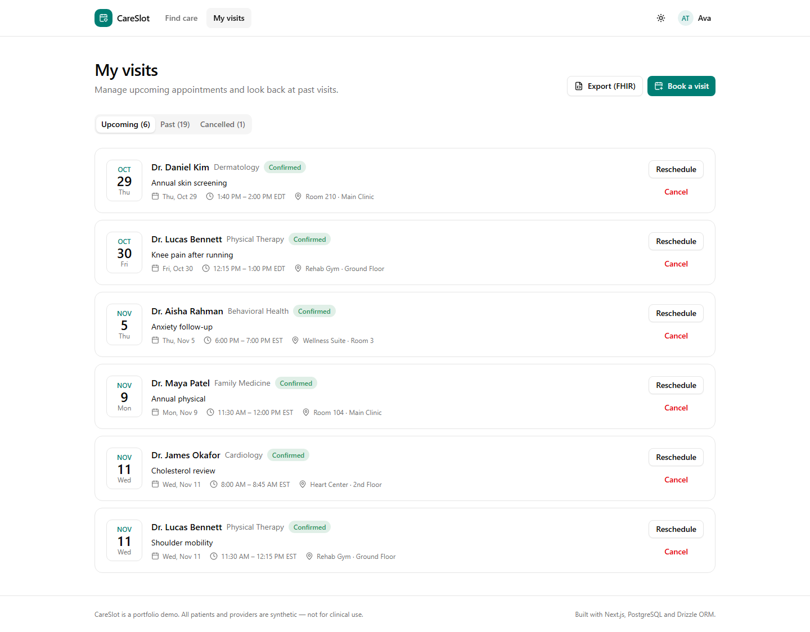
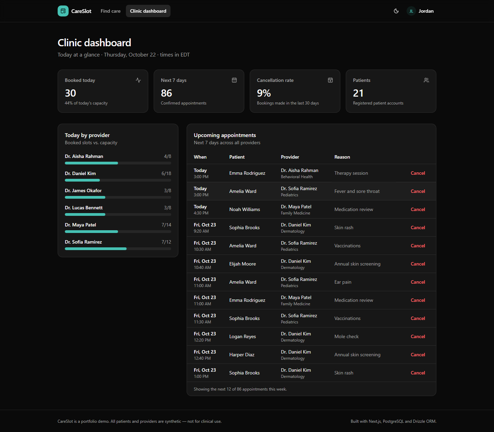

# CareSlot: Clinic Appointment Scheduler

[](https://github.com/Mdjamilh/clinic-appointment-scheduler/actions/workflows/ci.yml)


A full-stack scheduling app for an outpatient clinic. Patients find a provider, see real availability, and book, reschedule or cancel visits. Clinic staff get a live dashboard. Appointment data is also available through a **FHIR R4 API**, and an **AI intake helper** suggests the right specialty while catching emergency symptoms first.

> Portfolio project. All patients and providers are synthetic. Not for clinical use.



## Features

**Patients**
- Provider directory with search and specialty filters
- Weekly availability grid generated from each provider's working hours, in the clinic's timezone
- Book with a reason for visit; reschedule (the old slot is kept until the new one is confirmed) or cancel
- *My visits* with upcoming, past and cancelled tabs, plus an **Export (FHIR)** button
- **"Not sure who to see?"**: describe symptoms and get a suggested specialty. Red-flag phrases (chest pain, trouble breathing, stroke signs and more) show emergency advice instead

**Clinic staff**
- KPIs: booked today, utilization, next 7 days, 30-day cancellation rate
- Per-provider utilization for today and the upcoming appointment list, with cancel

**Interoperability**
- Read-only FHIR R4 endpoints for `Appointment` and `Practitioner`, plus a `CapabilityStatement`

| | |
|---|---|
|  |  |
|  |  |

## Tech stack

| Layer | Choice |
|---|---|
| Framework | Next.js 15 (App Router, Server Components, Server Actions) |
| Language | TypeScript (strict) |
| UI | Tailwind CSS v4, shadcn/ui (Radix), lucide icons, light and dark themes |
| Database | PostgreSQL via Drizzle ORM; embedded PGlite when no `DATABASE_URL` is set |
| Validation | Zod on every server action and API input |
| AI | Anthropic Claude API (structured output, refusal fallback), with rule-based fallback |
| Testing | Vitest (unit and integration against real Postgres), Playwright (end-to-end, desktop and mobile) |
| CI | GitHub Actions: lint, typecheck, unit tests, build, e2e |

## Engineering highlights

- **No double booking, even under concurrency.** A partial unique index on `(provider_id, starts_at) WHERE status = 'booked'` makes the database the final judge; the service turns the violation into a friendly "slot just taken" message. A test fires two simultaneous bookings and asserts exactly one wins.
- **Atomic rescheduling.** Cancel-and-rebook runs in one transaction, so a failed move leaves the original booking untouched (also tested).
- **Timezone-correct slots.** Availability is stored as weekly rules in clinic-local minutes and expanded with `@date-fns/tz`, so slots stay at 9:00 across daylight-saving changes.
- **Authorization on the server.** Every action and API route re-reads the session and checks ownership; patients get `404`, not `403`, for other people's FHIR records so existence isn't leaked.
- **Safety before AI.** The intake helper checks red flags with deterministic rules before any model call, constrains the model to the clinic's real specialties with a JSON schema, and falls back to keyword rules if the API is missing, fails or refuses.
- **Zero-config demo.** Without `DATABASE_URL`, the app boots an embedded Postgres (PGlite), runs migrations and seeds realistic data, so `npm run dev` just works.

More detail in [docs/ARCHITECTURE.md](docs/ARCHITECTURE.md).

## Getting started

Requires Node.js 20 or newer.

```bash
git clone https://github.com/Mdjamilh/clinic-appointment-scheduler.git
cd clinic-appointment-scheduler
npm install
npm run dev
```

Open http://localhost:3000 and pick a demo account on the sign-in page (no password). Ava, Noah and Priya are patients; Jordan is the clinic admin.

### Environment variables

Copy `.env.example` to `.env.local`. Everything is optional.

| Variable | Purpose |
|---|---|
| `DATABASE_URL` | Postgres connection string (for example a free [Neon](https://neon.tech) database). Without it, the embedded PGlite database is used. |
| `CLINIC_TIMEZONE` | IANA timezone for schedules. Default `America/New_York`. |
| `ANTHROPIC_API_KEY` | Turns on AI suggestions in the intake helper. Without it, keyword rules are used. |
| `ANTHROPIC_MODEL` | Optional model override. Default `claude-opus-5-5`. |

### Using your own Postgres

```bash
DATABASE_URL=postgres://... npm run db:migrate
DATABASE_URL=postgres://... npm run db:seed
```

## Scripts

| Command | What it does |
|---|---|
| `npm run dev` | Start the dev server |
| `npm run build` / `npm start` | Production build and server |
| `npm run lint` / `npm run typecheck` | ESLint and `tsc --noEmit` |
| `npm test` | Vitest unit and integration tests |
| `npm run test:e2e` | Playwright tests against a production build (run `npm run build` first) |
| `npm run db:generate` | Generate a migration after editing `src/db/schema.ts` |
| `npm run screenshots` | Re-capture README screenshots from a running app |

## FHIR API

```bash
# Public
curl http://localhost:3000/api/fhir/metadata
curl http://localhost:3000/api/fhir/Practitioner

# Requires the session cookie from signing in
curl -b "careslot_user=<user id>" \
  "http://localhost:3000/api/fhir/Appointment?status=booked&date=ge2026-10-01&_count=20"
```

Supported `Appointment` search parameters: `patient`, `practitioner`, `status` (`booked`, `fulfilled`, `cancelled`, comma-separated), `date` (repeatable, with `eq`/`ge`/`gt`/`le`/`lt` prefixes) and `_count` (max 200). Unknown parameters return `400` with an `OperationOutcome`.

## Deploying to Vercel

1. Import the repository in Vercel. No build settings need to change.
2. Optionally add a Neon Postgres database from the Vercel Marketplace (this sets `DATABASE_URL`), then run `npm run db:migrate` and `npm run db:seed` against it once.
3. Optionally add `ANTHROPIC_API_KEY`.

Without a database the deployment runs in demo mode: each server instance starts with fresh seeded data in memory, and bookings don't persist across cold starts.

## Project structure

```
src/
  app/            routes, server actions, FHIR route handlers
  components/     app components (ui/ holds shadcn primitives)
  db/             Drizzle schema, client, seed data
  lib/            pure helpers: slot generation, FHIR mapping, formatting
  server/         business logic: booking, queries, session, FHIR search, intake
e2e/              Playwright specs
drizzle/          SQL migrations
```

## Roadmap

- Real authentication (Auth.js) with provider accounts
- Email and SMS reminders
- FHIR `Slot` and `Schedule` resources and write support
- Waitlist that fills cancelled slots automatically

## License

[MIT](LICENSE)
